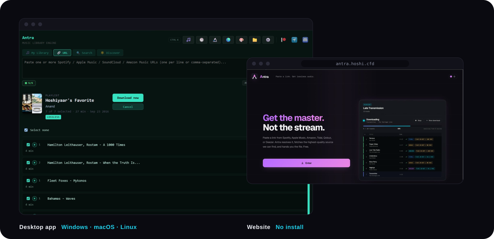

<p align="center">
  
</p>

<p align="center">
  
</p>

<p align="center">
  <sub>🌐 在线运行：<a href="https://antra.hoshi.cfd/">antra.hoshi.cfd</a></sub>
</p>

<p align="center">
  <strong>一个桌面端音乐库构建工具：把 Spotify、YouTube Music、Apple Music、Amazon Music、Tidal、Qobuz 和 Deezer 的链接，变成一个标签完整、格式为 FLAC / ALAC / AAC / MP3 的本地音乐库。</strong>
</p>

<p align="center">
  <a href="../../releases"></a>
  
  <a href="https://t.me/antraaverse"></a>
  <a href="https://discord.com/invite/gAJ3QymUta"></a>
</p>

<p align="center">
  <a href="../../releases">
    
  </a>
  &nbsp;
  <a href="FEATURES.md">
    
  </a>
</p>

---

> 本仓库是 [Antra](https://github.com/anandprtp/Antra) 的**简体中文汉化版**：界面、桌面端提示、音频分析器结论与文档均已汉化，功能与上游一致。原项目版权归原作者所有，详见 [LICENSE](LICENSE)。

## 这是什么

Antra 是一个桌面端音乐库管理工具。它帮你把歌曲整理进一个整洁的本地音乐库——自动写入完整元数据（标题、艺人、专辑、封面、流派和歌词），并按 `艺人 / 专辑` 的清晰目录结构归档，可直接配合 Navidrome、Jellyfin、Plex 等媒体服务器使用。

内置多套主题，可在「设置」里随意切换外观。

不需要装 Python，不需要繁琐配置，一个可执行文件搞定。

```
格式：    FLAC · ALAC · AAC · MP3
输出：    自动打标签 · 封面 + 歌词 · 媒体服务器开箱可用
```

→ **[功能详解](FEATURES.md)**

---

## 安装

从 [Releases](../../releases) 下载对应平台的构建版本，直接运行即可，无需安装。

| 平台 | 文件 |
|---|---|
| Windows 10 及以上 | `Antra.exe` |
| macOS 12 及以上（Apple Silicon） | `Antra-macOS.dmg` |
| macOS 12 及以上（Intel） | `Antra-macOS-Intel.dmg` |
| Linux | `Antra-Linux.AppImage` |

> **被 Windows Defender 报警？** 这是误报——打包后的应用有时会触发杀毒软件的启发式规则。本仓库包含全部源代码，可自行审查。

---

## 快速上手

1. 启动 Antra，首次运行时选择你的音乐库文件夹
2. 选择想要的输出格式
3. 粘贴一个链接
4. 点击 **添加到音乐库**

剩下的抓取、打标签、归档都会自动完成。

---

## 让 Antra 活下去

维护和改进 Antra 需要投入真实的时间。如果它对你有用，欢迎成为赞助者：

<p align="center">
  <a href="https://www.patreon.com/AntraVerse">
    
  </a>
</p>

---

> [!TIP]
> 给仓库点个 Star，就能直接在 GitHub 收到新版本通知。

---

## 参与贡献

感谢你有意为 Antra 出一份力。目前我并没有主动征集贡献，Pull Request 不一定能合并进主代码库。但无论如何，我都很感激你花的这份心思。

如果你发现了 bug，或者有功能想法，欢迎提 issue，我有空会看。

---

## 免责声明

本仓库及其内容仅用于学习与研究目的。如 LICENSE 文件中所述，本软件按「原样」提供，不附带任何明示或暗示的担保。

- 本仓库不托管、不存储、不镜像、也不分发任何受版权保护的内容。
- 用户需自行确保其对本软件的使用已获得适当授权，并遵守所有适用的法律、法规以及第三方服务条款。
- 本软件由维护者免费提供。如果你为了获取本仓库原始形态的软件而向第三方付费，你可能已被误导。第三方进行的任何再分发或商业使用都必须遵守本仓库的许可条款。除非另有书面明确声明，否则不构成维护者的任何关联、背书或支持。
- Antra 是一个独立项目，与其它平台上可能同名的项目或版本没有任何关联、背书或联系。维护者无法控制、也不对第三方项目负责。
- 作者不对因使用或误用本软件而产生的任何直接、间接、偶然或后果性损害承担责任。使用风险由用户自行承担。
- 如果你是版权持有人或授权代表，并认为本仓库侵犯了你的权利，请带着充分的细节（包括相关 URL 与权属证明）联系维护者。我们会尽快调查并采取适当措施，其中可能包括移除相关材料。

---

## 致谢先行者

特别感谢下面这几位，他们最早带来了新想法、反馈，并在所有人之前测试了测试版：

<p align="center">
  <a href="https://github.com/rafaelmolivebh">@rafaelmolivebh</a> &nbsp;·&nbsp;
  <a href="https://github.com/robarnoldio">@robarnoldio</a> &nbsp;·&nbsp;
  <a href="https://github.com/mishrabiswajit">@mishrabiswajit</a>
</p>

---

<p align="center">
  <sub>由 <a href="https://github.com/anandprtp">Hoshiyaar Singh</a> 用 ❤️ 打造 · <a href="../../issues">反馈问题</a> · <a href="https://t.me/antraaverse">Telegram</a> · <a href="https://discord.gg/gAJ3QymUta">Discord</a></sub>
</p>
